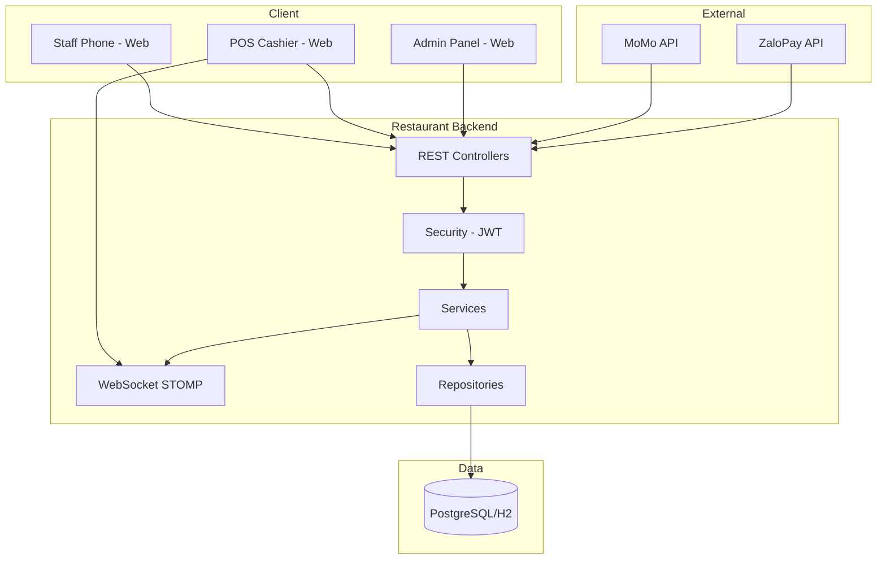

# System Architecture

> **Hướng dẫn sử dụng**: Kiến trúc hệ thống Restaurant Ordering Backend.

---

## 1. Tech Stack

### Core Technologies

| Layer | Technology | Version |
|-------|------------|---------|
| **Language** | `Java` | `21` |
| **Framework** | `Spring Boot` | `3.5.10` |
| **Database** | `PostgreSQL / H2` | `15+ / 2.x` |
| **Build Tool** | `Maven` | `3.8+` |
| **Realtime** | `WebSocket STOMP` | Built-in |

### Dependencies

| Dependency | Version | Purpose |
|------------|---------|---------|
| Spring Boot Web | 3.5.10 | REST API |
| Spring Boot WebSocket | 3.5.10 | STOMP realtime |
| Spring Boot Security | - | Authentication & Authorization |
| Spring Boot Data JPA | - | Database ORM |
| Spring Boot Validation | - | Request validation |
| PostgreSQL Driver | - | Production database |
| H2 Database | - | Development database |
| JWT (jjwt) | 0.11.5 | JWT token handling |
| Lombok | - | Boilerplate reduction |
| Flyway | - | Database migrations |

---

## 2. Architecture Pattern

```
[x] Layered (Controller-Service-Repository)
[x] Feature-based Package Structure
[x] Monolith + Single Artifact
```

### Rationale
```
- Monolith: Spring Boot serve REST + WebSocket + Static React build
- Single deployment: 1 VPS, cost-optimized cho quán nhỏ (~20 đơn/ngày)
- Feature-based: Mỗi module có controller/dto/entity/repository/service
```

---

## 3. System Diagram



---

## 4. Folder Structure

```
restaurant-backend/
├── src/main/java/com/restaurant/backend/
│   ├── RestaurantBackendApplication.java     # Main entry point
│   │
│   ├── config/                                # Global configurations
│   │   ├── SecurityConfig.java
│   │   ├── WebSocketConfig.java
│   │   ├── CorsConfig.java
│   │   └── JpaAuditConfig.java
│   │
│   ├── common/                                # Shared components
│   │   ├── dto/
│   │   │   ├── ApiResponse.java              # Standard response wrapper
│   │   │   └── PageResponse.java             # Pagination response
│   │   ├── entity/
│   │   │   └── BaseEntity.java               # id, createdAt, updatedAt
│   │   ├── enums/
│   │   │   ├── OrderStatus.java              # PENDING_CONFIRM, COOKING, DONE, SERVED, CANCELLED
│   │   │   ├── PaymentMethod.java            # CASH, MOMO, ZALOPAY
│   │   │   ├── PaymentStatus.java            # PENDING, SUCCEEDED, FAILED
│   │   │   ├── TableStatus.java              # AVAILABLE, OCCUPIED, DISABLED
│   │   │   └── UserRole.java                 # ADMIN, CASHIER, STAFF
│   │   └── exception/
│   │       ├── GlobalExceptionHandler.java
│   │       ├── ResourceNotFoundException.java
│   │       ├── BusinessException.java
│   │       └── ConflictException.java
│   │
│   ├── auth/                                  # Authentication module
│   │   ├── controller/AuthController.java
│   │   ├── dto/
│   │   │   ├── LoginRequest.java
│   │   │   └── LoginResponse.java
│   │   ├── service/
│   │   │   ├── AuthService.java
│   │   │   └── JwtService.java
│   │   └── filter/JwtAuthenticationFilter.java
│   │
│   ├── admin/                                 # Admin module
│   │   ├── area/
│   │   │   ├── controller/AreaController.java
│   │   │   ├── dto/
│   │   │   ├── entity/Area.java
│   │   │   ├── repository/AreaRepository.java
│   │   │   └── service/AreaService.java
│   │   ├── table/
│   │   │   ├── controller/TableController.java
│   │   │   ├── dto/
│   │   │   ├── entity/DiningTable.java
│   │   │   ├── repository/DiningTableRepository.java
│   │   │   └── service/TableService.java
│   │   └── user/
│   │       ├── controller/UserController.java
│   │       ├── dto/
│   │       ├── entity/User.java
│   │       ├── repository/UserRepository.java
│   │       └── service/UserService.java
│   │
│   ├── catalog/                               # Menu catalog module
│   │   ├── controller/MenuController.java
│   │   ├── dto/
│   │   │   ├── MenuItemResponse.java
│   │   │   └── OptionGroupResponse.java
│   │   ├── entity/
│   │   │   ├── MenuItem.java
│   │   │   ├── OptionGroup.java
│   │   │   ├── Option.java
│   │   │   └── MenuItemOptionGroup.java
│   │   ├── repository/
│   │   │   ├── MenuItemRepository.java
│   │   │   ├── OptionGroupRepository.java
│   │   │   └── OptionRepository.java
│   │   └── service/MenuService.java
│   │
│   ├── ordering/                              # Order management module
│   │   ├── controller/
│   │   │   ├── OrderController.java
│   │   │   └── PosController.java
│   │   ├── dto/
│   │   │   ├── OpenOrderRequest.java
│   │   │   ├── AddItemRequest.java
│   │   │   ├── OrderResponse.java
│   │   │   ├── OrderItemResponse.java
│   │   │   └── TransferRequest.java
│   │   ├── entity/
│   │   │   ├── Order.java
│   │   │   ├── OrderItem.java
│   │   │   ├── OrderItemOption.java
│   │   │   ├── TableTransfer.java
│   │   │   └── TableTransferItem.java
│   │   ├── repository/
│   │   │   ├── OrderRepository.java
│   │   │   ├── OrderItemRepository.java
│   │   │   └── TableTransferRepository.java
│   │   └── service/
│   │       ├── OrderService.java
│   │       ├── OrderServiceImpl.java
│   │       └── TransferService.java
│   │
│   ├── payment/                               # Payment module
│   │   ├── controller/PaymentController.java
│   │   ├── dto/
│   │   │   ├── CashPaymentRequest.java
│   │   │   ├── InitiatePaymentRequest.java
│   │   │   └── PaymentResponse.java
│   │   ├── entity/Payment.java
│   │   ├── repository/PaymentRepository.java
│   │   └── service/
│   │       ├── PaymentService.java
│   │       └── PaymentCallbackService.java
│   │
│   ├── realtime/                              # WebSocket module
│   │   ├── WebSocketEventPublisher.java
│   │   ├── dto/
│   │   │   └── OrderEvent.java
│   │   └── handler/OrderEventHandler.java
│   │
│   └── audit/                                 # Audit logging
│       ├── entity/AuditLog.java
│       ├── repository/AuditLogRepository.java
│       └── service/AuditService.java
│
├── src/main/resources/
│   ├── application.properties                 # Base config
│   ├── application-dev.properties             # H2 config
│   ├── application-prod.properties            # PostgreSQL config
│   └── db/migration/                          # Flyway migrations
│       ├── V1__create_area_table.sql
│       ├── V2__create_dining_table.sql
│       └── ...
│
├── src/test/java/com/restaurant/backend/
│   └── ordering/
│       ├── OrderServiceTest.java
│       └── OrderControllerTest.java
│
├── pom.xml
├── mvnw / mvnw.cmd
└── README.md
```

---

## 5. Key Design Decisions

### Decision 1: `Monolith Architecture`
- **Context**: Quán nhỏ, ~20 đơn/ngày, cần tối ưu chi phí
- **Decision**: Single artifact (Spring Boot + Static React)
- **Consequences**: 1 VPS deployment, dễ maintain, scale vertical nếu cần

### Decision 2: `WebSocket STOMP for Realtime`
- **Context**: POS cần thấy order realtime, Staff cần status updates
- **Decision**: Spring WebSocket STOMP
- **Consequences**: Native support, no external service, broadcast to topics

### Decision 3: `Optimistic Locking for Orders`
- **Context**: Nhiều staff có thể add items cùng lúc
- **Decision**: `@Version` trên Order entity
- **Consequences**: Conflict trả 409, client retry với version mới

### Decision 4: `Feature-based Package Structure`
- **Context**: Dễ navigate, mỗi module độc lập
- **Decision**: admin/, catalog/, ordering/, payment/, realtime/
- **Consequences**: Clear boundaries, easy to find related code

---

## 6. Environment Configuration

| Environment | URL | Purpose |
|-------------|-----|---------|
| **Local** | `localhost:8080` | Development |
| **Swagger** | `localhost:8080/swagger-ui.html` | API Testing |

### Profiles
| Profile | Database | Use Case |
|---------|----------|----------|
| `dev` | H2 file mode | Local development |
| `prod` | PostgreSQL | Production deployment |

---

## 7. Authentication & Authorization

### Auth Method
```
[x] Stateless JWT
[x] Role-based Access Control (RBAC)
[x] BCrypt Password Encryption
```

### Implementation Details
```
- JWT token với jjwt 0.11.5
- Token expiration: 24h
- Roles: ADMIN, CASHIER, STAFF
- JWT secret via environment variable
```

---

## 8. API Endpoints Summary

### Authentication
| Method | Endpoint | Role |
|--------|----------|------|
| POST | `/auth/login` | PUBLIC |
| GET | `/auth/me` | AUTHENTICATED |

### Admin: Area & Table
| Method | Endpoint | Role |
|--------|----------|------|
| POST | `/admin/areas` | ADMIN |
| GET | `/admin/areas` | ADMIN |
| PATCH | `/admin/areas/{id}` | ADMIN |
| POST | `/admin/tables` | ADMIN |
| GET | `/admin/tables?areaId=` | ADMIN |
| PATCH | `/admin/tables/{id}` | ADMIN |
| PATCH | `/admin/tables/{id}/disable` | ADMIN |
| PATCH | `/admin/tables/{id}/enable` | ADMIN |

### Public Tables
| Method | Endpoint | Role |
|--------|----------|------|
| GET | `/tables` | STAFF, CASHIER |

### Catalog
| Method | Endpoint | Role |
|--------|----------|------|
| GET | `/menu/items` | STAFF, CASHIER |
| GET | `/menu/items/{id}` | STAFF, CASHIER |

### Ordering
| Method | Endpoint | Role |
|--------|----------|------|
| POST | `/orders/open` | STAFF, CASHIER |
| GET | `/orders/open?tableId=` | STAFF, CASHIER |
| POST | `/orders/{orderId}/items` | STAFF, CASHIER |
| PATCH | `/orders/{orderId}/items/{itemId}` | CASHIER |
| DELETE | `/orders/{orderId}/items/{itemId}` | CASHIER |
| POST | `/orders/{orderId}/confirm` | CASHIER |
| POST | `/orders/{orderId}/status` | CASHIER |
| GET | `/pos/orders?status=` | CASHIER |

### Transfers
| Method | Endpoint | Role |
|--------|----------|------|
| POST | `/orders/{orderId}/transfer` | CASHIER |

### Payments
| Method | Endpoint | Role |
|--------|----------|------|
| POST | `/payments/cash` | CASHIER |
| POST | `/payments/initiate` | CASHIER |
| POST | `/payments/momo/callback` | PUBLIC |
| POST | `/payments/zalopay/callback` | PUBLIC |

### Print
| Method | Endpoint | Role |
|--------|----------|------|
| GET | `/orders/{orderId}/print/provisional` | CASHIER |
| GET | `/orders/{orderId}/print/receipt` | CASHIER |

---

## 9. WebSocket Topics

| Topic | Description | Subscribers |
|-------|-------------|-------------|
| `/topic/pos/orders` | All order events for POS | CASHIER |
| `/topic/tables/{tableId}` | Table-specific updates | STAFF on that table |
| `/topic/orders/{orderId}` | Order-specific updates | STAFF, CASHIER |

### Event Types
```
ORDER_CREATED
ORDER_ITEM_ADDED
ORDER_ITEM_UPDATED
ORDER_CONFIRMED
ORDER_STATUS_CHANGED
PAYMENT_UPDATED
TABLE_TRANSFERRED
```
